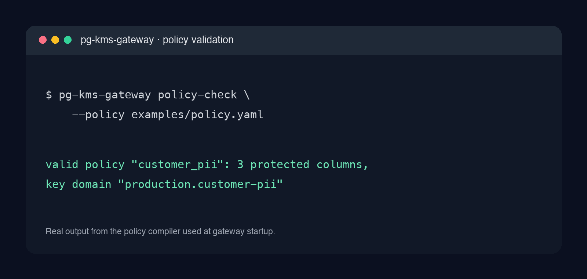
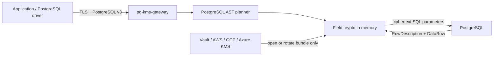

# pg-kms-gateway

> Part of [Vendora Infrastructure](https://github.com/vendora-bit) — small, secure and production-minded tools for databases and self-hosted infrastructure.

[](https://github.com/vendora-bit/pg-kms-gateway/actions/workflows/ci.yml)
[](https://github.com/vendora-bit/pg-kms-gateway/releases)
[](https://github.com/vendora-bit/pg-kms-gateway/pkgs/container/pg-kms-gateway)
[](LICENSE)

`pg-kms-gateway` is an application-agnostic PostgreSQL wire gateway for
field-level encryption. Applications keep using PostgreSQL v3; the gateway
parses SQL, encrypts policy-selected bind parameters before writes, and
decrypts proven result columns on reads.



## Why pg-kms-gateway

Adding encryption to a PostgreSQL application often couples every client to a
crypto SDK, KMS provider and schema convention. This gateway keeps the
PostgreSQL wire protocol at the application boundary while enforcing an
explicit, checked policy at a single point.

| Capability | pg-kms-gateway | Application-side crypto library | Transparent disk encryption |
| --- | --- | --- | --- |
| Field-level ciphertext | Yes | Yes, per application | No |
| PostgreSQL driver stays unchanged | Yes | No | Yes |
| KMS-backed envelope keys | Yes | Depends on each client | Not field-level |
| Policy and schema validation before ready | Yes | Custom implementation | No |
| Equality without plaintext | Opt-in blind index | Custom implementation | No |
| Explicitly rejects unsafe SQL | Yes | Varies | N/A |

## Quickstart — validate a policy in two minutes

The full gateway requires a PostgreSQL schema, a KMS provider and a reviewed
policy; do not point it at production as a first step. Start by running the
same validation the service uses before becoming ready:

```bash
git clone https://github.com/vendora-bit/pg-kms-gateway.git
cd pg-kms-gateway
docker build -t pg-kms-gateway:local .
docker run --rm \
  -v "$PWD/examples/policy.yaml:/work/policy.yaml:ro" \
  --entrypoint /usr/local/bin/pg-kms-gateway \
  pg-kms-gateway:local policy-check --policy /work/policy.yaml
```

The release image is available after the first public release:

```bash
docker run --rm ghcr.io/vendora-bit/pg-kms-gateway:latest version
```

Then read the [design](docs/design.md), [threat model](docs/threat-model.md),
[Vault configuration](examples/config-vault.yaml) and [Helm chart](charts/pg-kms-gateway/)
before configuring `serve`.

## Why not use X?

**Use application-side encryption** when you control every writer and reader,
need application-specific transformations, and can safely operate crypto/KMS
logic in each client. This gateway is for teams that need one policy-enforced
PostgreSQL protocol boundary.

**Use PostgreSQL disk or volume encryption** when your concern is stolen media
or backups at rest. It does not protect selected fields from ordinary database
read access, so it is complementary rather than equivalent.

**Use a general database proxy** when you only need pooling, routing or TLS.
This gateway intentionally understands a bounded subset of PostgreSQL SQL to
fail closed for protected fields; it is not a drop-in replacement for PgBouncer.

This project is an independent clean implementation with its own source layout,
protocol state machine, policy, envelope, key bundle, tests, and documentation.
Its canonical Go module is `github.com/vendora-bit/pg-kms-gateway`.

## Security model

- Randomized encryption: AES-256-GCM.
- Deterministic encryption: AES-SIV from Google Tink, opt-in only.
- Equality search for randomized fields: HMAC-SHA-256 blind-index columns with
  an independent key.
- Envelope encryption: one versioned bundle contains independent random,
  deterministic, and blind-index data keys. Only KMS-wrapped material is stored.
- KMS providers: HashiCorp Vault Transit, AWS KMS, Google Cloud KMS, and Azure
  Key Vault. Development-only local wrapping exists only as an internal test
  provider.
- AEAD context binds format, key domain, schema, table, column, mode, and JSON
  path. KMS wrapping binds immutable bundle metadata.
- Client and upstream TLS are independent; TLS 1.3 is the default minimum.

Text envelopes are self-describing:

```text
$PGXENC$2:<r|d>:<data-key-id>:<base64url-payload>
$PGXIDX$1:<data-key-id>:<base64url-hmac>
```

Ordinary plaintext may coexist during online backfill. A malformed value using
the reserved `$PGXENC$` prefix always fails closed.

## Request path



KMS is not called per row. It is required to initialize, open, rotate, or
rewrap the small data-key bundle.

## Policy

See [`examples/policy.yaml`](examples/policy.yaml). Random mode is the default.
Normalization is explicit because it changes equality semantics. JSON support
is limited to bounded dotted object paths; wildcards and array traversal are
rejected.

The gateway validates every configured table, column, blind-index column,
PostgreSQL type, table OID, and attribute number before readiness.

## SQL compatibility

Protected data supports parameterized:

- `INSERT ... (explicit columns) VALUES (...)`;
- `UPDATE ... SET column = $n`;
- `SELECT` and `DELETE` with direct equality predicates;
- `RETURNING` and wildcard projections resolved from PostgreSQL origin metadata;
- extended protocol prepared statements, named portals, and simple read queries.

Unsafe shapes fail before PostgreSQL: protected literals, hidden parameters,
functions over protected values, ambiguous joins, `COPY`, `MERGE`, stored
procedures, multi-statement strings, binary formats for protected fields, and
DDL. `BEGIN`, `COMMIT`, `ROLLBACK`, `SET`, and `SHOW` pass through. Schema
migrations use a direct administrative connection, then restart the gateway so
startup validation recompiles OID metadata.

## Commands

```text
pg-kms-gateway policy-check --policy policy.yaml
pg-kms-gateway keys-init --config config.yaml
pg-kms-gateway serve --config config.yaml
pg-kms-gateway backfill --config config.yaml --batch 250
pg-kms-gateway keys-rotate --config config.yaml
pg-kms-gateway reencrypt --config config.yaml --batch 250
pg-kms-gateway verify --config config.yaml --batch 250
pg-kms-gateway keys-prune --config config.yaml
pg-kms-gateway keys-rewrap --config config.yaml
```

`backfill` and `reencrypt` use bounded transactions, `FOR UPDATE SKIP LOCKED`,
a fixed scan boundary, and compare-and-swap updates. They are restartable and
never log values. `verify` performs AEAD, mode, active-key, JSON-path, and
blind-index checks without modifying data.
`keys-prune` repeats deep verification and removes decrypt-only key versions
only when every protected value and index is active and valid.

## Build and test

```bash
go test ./...
go test -race ./...
go vet ./...
go build -trimpath ./cmd/pg-kms-gateway
```

The `integration` build tag runs a real pgx → gateway → PostgreSQL test. CI also
builds the non-root distroless image, lints Helm, fuzzes envelope parsing, runs
CodeQL, scans releases with Trivy, emits SPDX SBOM and build provenance, and
signs multi-architecture images with Cosign.

## Operations

- `/livez` reports process liveness.
- `/readyz` is exposed only after policy, bundle, KMS unwrap, schema discovery,
  and listeners initialize.
- `/metrics` exposes Prometheus counters without SQL or customer labels.
- Key bundles are mounted read-only and must be distributed atomically to all
  replicas. A KEK rewrap does not change row ciphertext.

See [`docs/design.md`](docs/design.md), [`SECURITY.md`](SECURITY.md), the
[`Dockerfile`](Dockerfile), and the [`Helm chart`](charts/pg-kms-gateway).

## Roadmap

- [x] PostgreSQL v3 protocol gateway, policy enforcement and KMS-backed envelope keys
- [x] Vault, AWS, GCP and Azure KMS providers; Helm, SBOM, provenance and signing
- [ ] More production rollout recipes and policy schema reference
- [ ] Additional explicitly proven SQL forms, added only with negative coverage
- [ ] Pluggable external authorization decision point

See [CONTRIBUTING.md](CONTRIBUTING.md) and the prepared
[good first issues](.github/GOOD_FIRST_ISSUES.md).

## Release and license

The current code and Helm chart version is `0.1.0`. Pushing a signed `v0.1.0`
tag publishes a signed multi-architecture GHCR image, SBOM, provenance, Helm
chart and GitHub Release. See [CHANGELOG.md](CHANGELOG.md).

Released under [Apache-2.0](LICENSE). See [SECURITY.md](SECURITY.md) for
private vulnerability reporting.

## Related tools

- [cert-renewer](https://github.com/vendora-bit/cert-renewer) — safe multi-lineage Let's Encrypt reconciliation.
- [ddns-updater](https://github.com/vendora-bit/ddns-updater) — safe Cloudflare DDNS synchronization.
