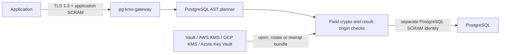

# pg-kms-gateway

`pg-kms-gateway` is a policy-driven PostgreSQL field-level encryption gateway for protecting PII, credentials and other sensitive database columns at rest. Applications use the PostgreSQL v3 protocol; the gateway parses SQL, transforms approved bind parameters before they reach PostgreSQL and decrypts only result columns whose origin is proven.

The project is application-agnostic. A strict core handles PostgreSQL wire state, SQL qualification, authenticated encryption and key lifecycle. Versioned application profiles add reviewed policies and SQL corpora for specific frameworks without putting application logic into the gateway.

## Why field-level PostgreSQL encryption

Disk, volume and managed-database encryption protect lost media and snapshots, but PostgreSQL still processes and returns ordinary plaintext. Field-level encryption changes that boundary: selected columns are stored as authenticated ciphertext, while data-encryption keys are wrapped by Vault Transit, AWS KMS, Google Cloud KMS or Azure Key Vault.

Typical uses include GDPR and PII protection, reducing plaintext exposure in database dumps, separating application credentials from PostgreSQL credentials and rotating encryption keys without stopping application traffic.

## Security properties

- AES-256-GCM randomized encryption is the default.
- AES-SIV deterministic encryption is opt-in for exact equality lookup.
- Randomized fields can use an HMAC-SHA-256 blind-index column with an independent key.
- AEAD additional data binds the format, key domain, schema, table, column, mode and optional JSON path.
- Data keys are generated by the operating-system CSPRNG and stored only as KMS-wrapped bundle entries.
- Old data-key versions remain decrypt-only during online rotation and are removed only after deep verification.
- SQL involving protected data is fail-closed: an unsupported or ambiguous shape is rejected before forwarding.
- A reserved ciphertext marker in an unproven result column terminates the session instead of leaking ciphertext.
- Client-facing TLS 1.3 and upstream TLS are independent. Client TLS is required by default.
- Production authentication termination uses SCRAM-SHA-256 with separate application and PostgreSQL credentials.

Stored text envelopes are self-describing:

```text
$PGXENC$2:<r|d>:<data-key-id>:<base64url-payload>
$PGXIDX$1:<data-key-id>:<base64url-hmac>
```

Envelope metadata is authenticated, not trusted. A bind value that literally begins with `$PGXENC$` is encrypted like any other plaintext. Once stored, a malformed value carrying the reserved prefix is fatal on reads and verification.

## Request path



KMS is not called per row. Normal reads and writes use unwrapped data keys held in gateway process memory.

## Supported PostgreSQL SQL

For protected relations, the current policy version accepts a deliberately small parameterized subset:

- `INSERT` with an explicit column list and `VALUES` bind parameters;
- `UPDATE` with direct bind parameters in protected assignments;
- `SELECT`, `UPDATE` and `DELETE` with direct equality predicates;
- `RETURNING`, direct projections and `*` projections proven with table OID and attribute number;
- named and unnamed prepared statements, named portals, pipelined extended-protocol batches and `PortalSuspended`;
- transaction control plus `SET` and `SHOW`.

The encrypted endpoint rejects `COPY`, `MERGE`, DDL, multi-statement strings, dynamic SQL, stored procedure calls, protected literals, joins or nested relations involving protected tables, function-wrapped protected predicates and binary formats for protected fields. Run schema migrations through a separate administrative connection, then restart the gateway to recompile PostgreSQL origin metadata.

## Quick start

1. Create a policy from [`examples/policy.yaml`](examples/policy.yaml).
2. Create a configuration from [`examples/config-vault.yaml`](examples/config-vault.yaml).
3. Initialize the wrapped data-key bundle.
4. Start the gateway and point the application at port `6432` using its gateway-only credential.
5. Run online backfill; mandatory deep verification runs automatically before the command succeeds.

```bash
pg-kms-gateway policy-check --policy policy.yaml
pg-kms-gateway keys-init --config config.yaml
pg-kms-gateway serve --config config.yaml
pg-kms-gateway backfill --config config.yaml --batch 250
```

See [Getting started](docs/getting-started.md), [configuration reference](docs/configuration.md), [policy reference](docs/policy-reference.md) and [Kubernetes deployment](docs/kubernetes.md).

## Key rotation

```bash
pg-kms-gateway keys-rotate --config config.yaml
# atomically distribute the new bundle revision and restart/roll all replicas
pg-kms-gateway reencrypt --config config.yaml --batch 250
pg-kms-gateway verify --config config.yaml --batch 250
pg-kms-gateway keys-prune --config config.yaml
```

`keys-rewrap` changes the KEK wrapping without rewriting row ciphertext. Rotation details and rollback rules are documented in [Key management and rotation](docs/key-management.md).

## Application profiles

Profiles contain a versioned policy, sanitized SQL corpus and compatibility contract. The included Keycloak 26 core PII profile is intentionally scoped and does not claim complete runtime compatibility until the target Keycloak patch release passes the documented E2E gate.

```bash
pg-kms-gateway corpus-verify \
  --policy profiles/keycloak/26/policy.yaml \
  --corpus profiles/keycloak/26/corpus.json
```

See [`profiles/README.md`](profiles/README.md) and [Application profiles](docs/application-profiles.md).

## Build, test and release verification

```bash
go test ./...
go test -race ./...
go vet ./...
go build -trimpath ./cmd/pg-kms-gateway
```

CI runs unit, race, AST fuzz, real PostgreSQL wire, pipeline, prepared statement, connection-pool, cancel and TLS/SCRAM tests. Releases are multi-architecture images with an SPDX SBOM, Trivy vulnerability gate, Sigstore Cosign signature and GitHub build-provenance attestation.

## Documentation

- [Architecture and invariants](docs/design.md)
- [Getting started](docs/getting-started.md)
- [Configuration reference](docs/configuration.md)
- [Encryption policy reference](docs/policy-reference.md)
- [PostgreSQL protocol compatibility](docs/postgresql-protocol.md)
- [Encryption format and cryptography](docs/cryptography.md)
- [KMS providers and key rotation](docs/key-management.md)
- [Backfill, verification and migrations](docs/migrations.md)
- [Kubernetes and Helm deployment](docs/kubernetes.md)
- [Operations, monitoring and troubleshooting](docs/operations.md)
- [Application conformance profiles](docs/application-profiles.md)
- [Threat model](docs/threat-model.md)
- [Security hardening checklist](docs/security-hardening.md)
- [External audit scope](docs/audit-scope.md)

Security reports follow [`SECURITY.md`](SECURITY.md). Contributions follow [`CONTRIBUTING.md`](CONTRIBUTING.md).
